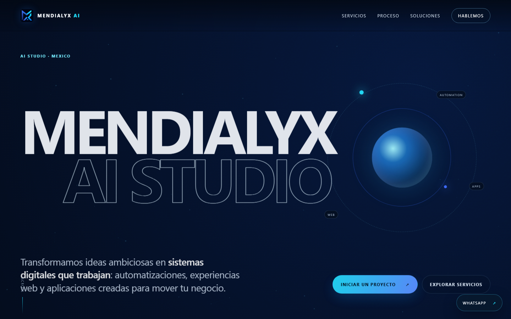

# Mendialyx AI — sitio web

Sitio de presentación de **Mendialyx AI**, un estudio mexicano de automatización con IA, sitios web, aplicaciones a la medida y chatbots para negocios.

**Sitio en vivo:** https://mendialyx.pages.dev/

## Qué incluye

- Sitio de una sola página, responsivo y con animaciones de aparición al hacer scroll que respetan `prefers-reduced-motion`.
- **Asistente calificador de prospectos:** un flujo guiado de preguntas (servicio, giro, alcance) que arma un mensaje de WhatsApp con el contexto del prospecto. Funciona sin servidor.
- Formulario de contacto que abre WhatsApp con el mensaje ya redactado.
- SEO básico: metadatos, `sitemap.xml`, `robots.txt` y manifiesto web.
- Cabeceras de seguridad para Cloudflare Pages (`_headers`).

## Stack

HTML, CSS y JavaScript sin dependencias ni paso de compilación. Se despliega en Cloudflare Pages.

## Estado

En producción. Pendientes: dominio propio y aviso de privacidad.

## Licencia

Copyright (c) 2026 Ángel Mendiola. Todos los derechos reservados. El código se publica para evaluación profesional; no se concede licencia de uso, copia ni modificación. Ver [`LICENSE`](LICENSE).
